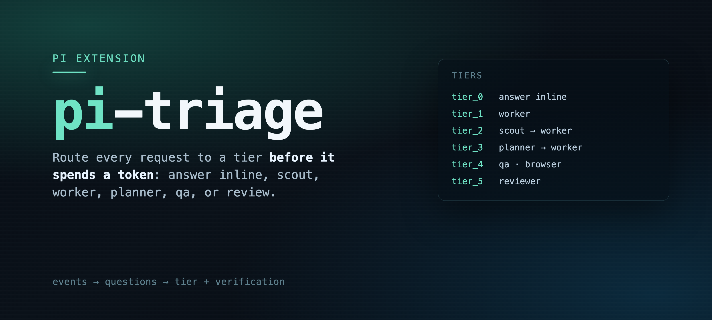

<p align="center">
  
</p>

# pi-triage

One tool that decides **how much work a request deserves** before any of it
happens: answer inline, send a `worker`, map first with a `scout`, plan first,
drive a browser, or ask for a review.

```
tier_0  answer inline
tier_1  worker
tier_2  scout → worker
tier_3  planner → worker
tier_4  qa (browser)
tier_5  reviewer
```

The point is not classification for its own sake. It is that the expensive
routes are the ones that spawn sub-agents and burn tokens, and a wrong route is
silently paid for. So the tool returns a **tier, a confidence, a verification
level, and the exact route string** — and says when it is not sure.

## Install

```bash
pi install git:github.com/tripplen23/pi-triage
```

Then call it once at the start of a request that may need work:

```typescript
triage({ prompt: "<the user's request, verbatim>" })
```

Pass the wording **verbatim**. Rewriting or translating it throws away the signal
the engines were measured on.

## What you get back

```
Triage Result: tier_3 (confidence 100%) — via jev
Route: subagent({ agent: "planner", … }) — it writes a spec to .pi/plans/<slug>.md.
Show that spec to the user before spawning workers.
Agent: planner → worker
Verification: reviewer — get a verdict from subagent({ agent: "reviewer" })
```

A result below the floor for its tier carries a warning and expects confirmation
before anything is spawned. `tier_3`, `tier_4_qa` and `tier_5_review` are never
authorised by a guess.

## How it decides

Four sources, in this order, and each one says who answered (`via jed|laya|heuristic|crumb`):

| Source | What it is | Notes |
|---|---|---|
| `crumb` | "ok", "ship it", "go on" | no decision needed, answered inline |
| `jev` | a hosted decision model (`jev-1.13` on OpenRouter) | most accurate, ~0.5s, 2.5s timeout |
| `laya` | a self-hosted decision engine | slower (~6s), weaker on this set, generalises better than a regex |
| `heuristic` | keyword rules (`fallback.ts`) | last resort; confidence hard-capped at 0.6, so it can never authorise a planner/qa/review route on its own |

The two "noul" questions (`is_ui_test`, `is_code_review`) are asked separately
from `task_tier` so a keyword cannot steal a route: a bug report that mentions
clicking stays a fix, and "review the plan" stays a plan.

UI wins over review when both fire, because the reviewer has no browser.

## Credentials

| Engine | How it is found |
|---|---|
| `jev` | `OPENROUTER_API_KEY`, else pi's own credential store (what `/login` writes), else `OPENROUTER_API_KEY` in `~/.config/laya/env` |
| `laya` | `LAYA_URL` + `LAYA_API_KEY`, else the same env file |

With neither configured it still works: you get the heuristic path with its
low-confidence warning. Nothing is spawned on a guess.

Every call is appended as one JSON line to `~/.pi/agent/triage.log`, so a wrong
route can be argued with evidence instead of memory.

## Layout

| File | Job |
|---|---|
| `index.ts` | the tool: source order, credentials, warnings, route text |
| `questions.ts` | the question set and the confidence floors (rich criteria on purpose) |
| `compose.ts` | folds answers into one tier + verification; no pi imports, so it is testable |
| `fallback.ts` | the keyword classifier and its ceiling; no pi imports |

## Tests

```bash
npm test        # node --test: compose + fallback, no network, no model
npm run typecheck
```

CI runs both on every pull request and on `main`.

## License

MIT. See [LICENSE](./LICENSE).
